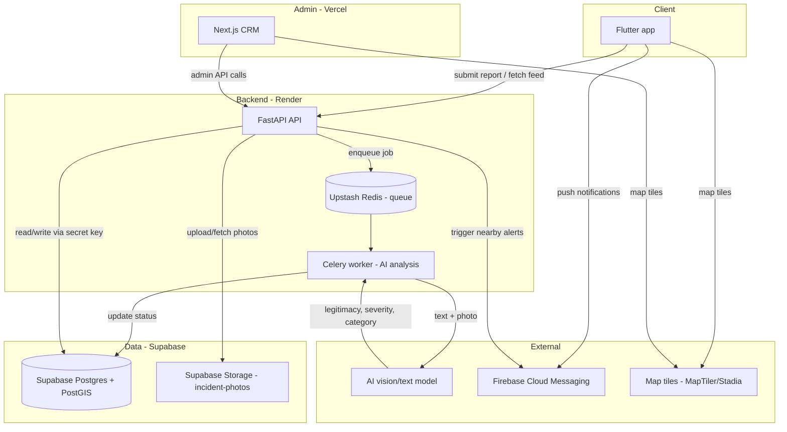
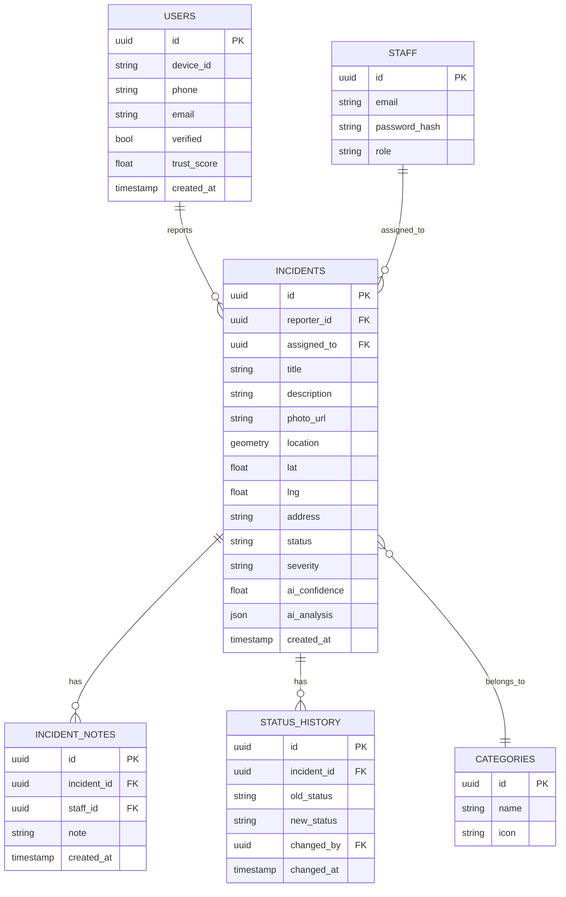
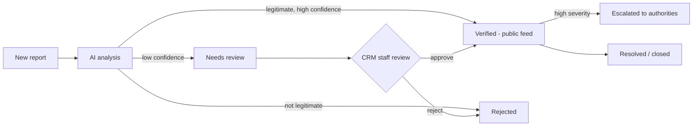

# Incident reporting platform — technical & product plan
> Updated: Supabase-only for now. No Supabase Auth. No Supabase Functions.

## 1. Overview

A citizen incident-reporting system:

- **Flutter app** — users report incidents (crime, hazards, city issues) with text + photo, and browse verified incidents on a map/feed.
- **FastAPI backend (on Render)** — receives reports, runs fully-automated AI legitimacy/severity checks, stores map data, sends push notifications to nearby users.
- **Next.js CRM (on Vercel)** — ops team reviews/overrides AI decisions, monitors analytics, manages users, escalates serious incidents.
- **Supabase (only cloud data store for now)** — holds the database (Postgres + map helper) + holds photos (Storage bucket). Nothing else from Supabase is used.

Decisions locked in this round:
1. Supabase only for data + photos. No Cloudflare DB (Cloudflare D1 is simple SQLite-type, can't do "near me" map search. Cloudflare only connects to Postgres that lives elsewhere, it doesn't host it).
2. Photos go App -> Backend -> Supabase Storage (backend validates first, then saves). No direct app-to-storage upload.
3. Login is our own from day one: anonymous device ID + phone/email code check. No Supabase Auth.
4. Backend + worker live on Render, background queue uses Upstash Redis (Supabase can't run these).
5. No Supabase Functions / Edge Functions / Realtime / RLS. All helper logic stays in FastAPI so we can move later easily.
6. Future Cloudflare move = only for photos (R2) if needed. Database stays on Supabase-type Postgres.

Anonymous reporting is allowed; verified (phone/email) users get higher trust weighting. Verification is included in MVP (not later).

## 2. System architecture

Rules:
- App + CRM never talk to Supabase directly. Only FastAPI talks to Supabase with secret key.
- No direct Supabase client keys in app. Keeps us safe + portable.

## 3. Tech stack

### Flutter app (citizen-facing)
| Concern | Choice |
|---|---|
| State management | Riverpod (or Bloc) |
| Map | `flutter_map` (open-source, no Google Maps needed) |
| Map tiles | MapTiler or Stadia Maps free tier |
| Location | `geolocator` |
| Camera/photo | `image_picker` / `camera` |
| Push notifications | Firebase Cloud Messaging (free) |
| HTTP | `dio` |
| Auth token storage | `flutter_secure_storage` |
| Auth | Our own: anonymous device ID on first open + phone/email code verify in MVP |

### FastAPI backend (on Render)
| Concern | Choice |
|---|---|
| Framework | FastAPI (Python) |
| Database | Supabase Postgres + PostGIS extension (map search) |
| ORM | SQLAlchemy + GeoAlchemy2 (plain Postgres, no Supabase-only features) |
| Migrations | Alembic via direct DB link (not pooler link) |
| Async jobs | Celery + Upstash Redis (AI analysis, notification dispatch) |
| AI analysis | Vision-capable LLM API (text + photo → legitimacy, category, severity, confidence) |
| Auth | Our own JWT: anonymous session + verified flag. No Supabase Auth. |
| File storage | Supabase Storage bucket `incident-photos` via backend (S3-style layer so we can swap to R2 later by changing keys only) |
| Push notifications | Firebase Admin SDK |
| Supabase client | `supabase-py` with service key server-side only, or plain `psycopg2`/`asyncpg` + `boto3`-style storage calls. No RLS, no Realtime. |

### Next.js CRM (admin/ops on Vercel)
| Concern | Choice |
|---|---|
| Framework | Next.js (React) |
| UI | Tailwind CSS + shadcn/ui |
| Data fetching | TanStack Query (talks to FastAPI only, not Supabase directly) |
| Map/heatmap | `react-leaflet` (same OSM-based tiles as the app) |
| Charts | Recharts |
| Auth | Our JWT-based staff login, role-based access (dispatcher, analyst, admin) |

### Hosting (locked)
- **Database + photos**: Supabase (free tier to start: ~500MB DB, 1GB storage). Enable `postgis` extension in one click.
- **Backend + worker**: Render (FastAPI web service + Celery worker service)
- **Queue**: Upstash Redis (free tier, works with Celery)
- **CRM frontend**: Vercel (free tier)
- **Push**: Firebase Cloud Messaging (free, unlimited)
- **Map tiles**: MapTiler or Stadia Maps (free tier, ~100-200k loads/month)
- **Geocoding**: Nominatim (free, low volume) or MapTiler Geocoding

What we DON'T use in Supabase: Auth, Edge/Functions, Realtime, RLS policies, Vault. Reason: avoid lock-in + keep Cloudflare/R2 move simple later.

Total infra cost at MVP stage: **$0–10/month**.

## 4. Data model (lives in Supabase Postgres)

Same tables, with Supabase setup notes:

Supabase setup:
1. New project -> SQL editor -> `create extension postgis;`
2. `location` = map point type. Add simple index for "near me" speed. Keep `lat/lng` columns too for easy app use.
3. Storage: create private bucket `incident-photos`, backend uploads with service key, app/CRM get short signed links via FastAPI.
4. Connections: app runtime uses pooler link (port 6543, transaction mode). Alembic migrations use direct link (port 5432).
5. RLS OFF (backend is the gate). All access via FastAPI service key.

## 5. Auth (our own, verification from day one)

No Supabase Auth.

1. App first open -> make random `device_id` -> call `POST /auth/anonymous` -> get JWT (verified=false, low trust).
2. User adds phone/email -> backend sends 6-digit code (email via Resend/SMTP, SMS via Twilio/Firebase for MVP) -> user enters code -> `POST /auth/verify` -> JWT upgraded (verified=true, higher trust).
3. All report/feed calls send JWT. Staff login separate (`/admin/login` email+password, roles in STAFF table).
4. Trust score: starts 0.5 anonymous / 0.8 verified. False reports lower it, accurate reports raise it. AI + CRM use it as weight.

## 6. Photo flow (via backend)

1. App sends `multipart/form-data` (title, description, lat, lng, photo) to `POST /incidents` with JWT.
2. FastAPI checks file type/size, saves row as `processing`, uploads bytes to Supabase `incident-photos/{id}.jpg`.
3. Store public path or signed-link base in `photo_url`. Don't expose Supabase secret to app.
4. Celery worker fetches photo link + text for AI check.
5. Later R2 move = only change upload helper (key stays same), no app change.

## 7. AI pipeline (fully automated, on Render worker)

1. User submits report (text + photo) from the Flutter app.
2. FastAPI stores the incident as `processing`, uploads the photo to Supabase Storage.
3. A Celery background job (Upstash Redis queue) sends the text + photo link to a vision-capable AI model with a structured prompt asking for:
   - `is_legitimate` (bool)
   - `category` (crime / fire / accident / hazard / other)
   - `severity` (low / medium / high / critical)
   - `confidence` (0–1)
4. The worker updates the incident's status automatically: `verified`, `rejected`, or `needs_review` (low confidence).
5. If verified and severity crosses a threshold, the backend triggers push notifications to users within a radius ("near me" DB query) and publishes it to the public feed.
6. The CRM can override any AI decision at any time — every override is logged to `STATUS_HISTORY` for audit and future model tuning.

## 8. Maps without Google Maps

Since budget for Google Maps API is a constraint:

- **`flutter_map`** — free, open-source Flutter package with full marker/clustering/overlay support.
- **Tile provider** — Stadia Maps or MapTiler free tier (OSM-based tiles, no credit card required to start).
- **Geocoding** — Nominatim (OSM's free geocoder) for low-volume address lookups.
- **Backend map search** — Supabase PostGIS handles "incidents within X km" efficiently.
- **CRM map/heatmap** — `react-leaflet` using the same tile provider, so map behavior is consistent across app and CRM.

This costs **$0 to start**, scaling to paid tiers only once traffic grows significantly.

## 9. CRM features

Core:
- Review/override AI legitimacy & severity decisions
- Analytics & heatmaps of incidents (by area, category, time)
- Escalate incidents to authorities / export reports (PDF/CSV)
- User management (verify accounts, ban spammers/abusive reporters)
- Assign incidents to staff or teams

Suggested additions:
- **Incident status workflow**: `new → ai_reviewed → verified/rejected → escalated → resolved/closed`
- **Duplicate detection**: cluster multiple reports of the same real-world event
- **Internal notes/comments** thread per incident for team collaboration
- **Role-based access**: dispatcher, analyst, admin — different permission levels
- **Audit trail**: every status change and override logged with who/when
- **Automated alerts**: Slack/email/SMS webhook when a critical-severity incident comes in
- **Bulk actions**: dismiss spam/duplicate reports in bulk
- **Trust score feedback loop**: reporters with repeated false reports lose trust weighting; verified/accurate reporters gain it
- **Public status broadcasts**: ops can push "avoid this area" alerts independent of individual incidents

All CRM data via FastAPI admin APIs. No direct Supabase queries from browser.

## 10. Status workflow

## 11. Notifications

- Nearby-incident push alerts via Firebase Cloud Messaging.
- Trigger: incident becomes `verified` + severity ≥ threshold → Supabase "near me" query for subscribed users → Celery sends FCM push.
- Users can configure their alert radius and severity threshold in-app.
- Store FCM tokens in USERS table (add `fcm_token`, `alert_radius_km`, `min_severity`).

## 12. Supabase use / don't-use + future move

Use: Postgres + PostGIS + Storage only.
Don't use: Auth, Functions, Realtime, RLS, Vault.

Why: keeps code plain Postgres so any future move is copy-tables + change link. Photo helper is S3-style so R2 swap = config change only. Hyperdrive / Cloudflare Postgres = just a faster link to the same Supabase/Neon DB, not a replacement.

## 13. Roadmap (Supabase edition)

| Phase | Duration | Deliverables |
|---|---|---|
| 0. Setup | ~1 week | Supabase project + postgis + bucket, Render + Upstash + Vercel + Firebase accounts, repos |
| 1. Core backend | 2–3 weeks | Custom auth (anonymous + code verify), incident CRUD, Alembic tables, backend photo upload to Supabase, AI integration |
| 2. Flutter MVP | 3–4 weeks | Report submission via backend, map/list feed, login + verify screens, push setup |
| 3. CRM MVP | 2–3 weeks | Dashboard, review/override, basic analytics, user management via FastAPI |
| 4. AI & notifications | 2 weeks | Prompt tuning, severity thresholds, nearby push alerts via Celery |
| 5. Polish & launch | 2 weeks | Heatmaps, escalation/export, RBAC, testing, deployment |

**Total: ~12–15 weeks** for a small team; longer if solo.

## 14. Open questions for next round

- What authorities/agencies (if any) need direct integration for escalation?
- Expected initial geographic scope (one city, region, nationwide)?
- Any compliance/data-privacy requirements (especially given crime-related data)?
- Code sender choice for verification: email (Resend) + SMS (Twilio vs Firebase) — which to use for MVP?
